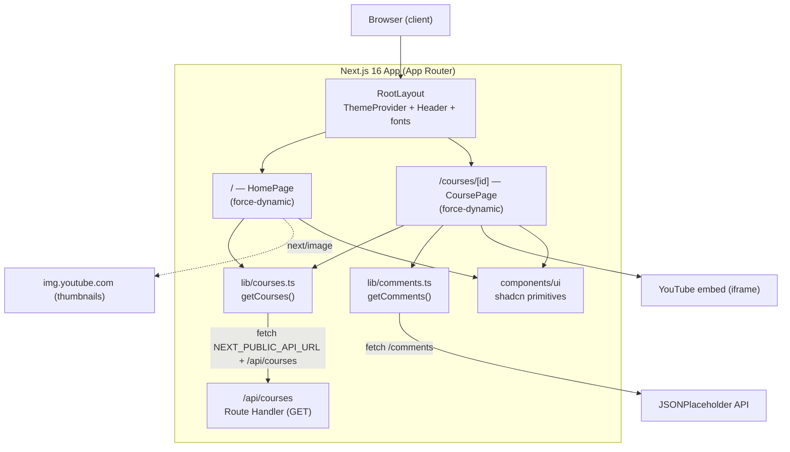

# IT Legend — Learn Web Development

A production-quality course catalog web application for learning front-end and modern web development. IT Legend lets visitors browse a curated set of courses, open a detailed course page with a video, curriculum, progress tracking, and community-style comments, and switch between light and dark themes.

The project doubles as a showcase of a modern Next.js App Router stack: server components, route handlers, streaming with Suspense, a small design system built on shadcn/ui primitives, and a strict three-color visual identity.

**Intended audience:** learners exploring web development, and developers/recruiters reviewing a modern Next.js + React 19 + Tailwind v4 codebase.

> **Repository:** <https://github.com/ahmed-dev-reda/it-legend-challenge> (from the configured `origin` remote)

---

## Table of Contents

- [Introduction](#introduction)
- [Key Features](#key-features)
- [Screenshots and Demo](#screenshots-and-demo)
- [Technology Stack](#technology-stack)
- [Project Architecture](#project-architecture)
- [Folder and File Structure](#folder-and-file-structure)
- [Installation and Setup](#installation-and-setup)
- [Environment Variables](#environment-variables)
- [Application Routes and Pages](#application-routes-and-pages)
- [Data Layer and Data Models](#data-layer-and-data-models)
- [Authentication and Authorization](#authentication-and-authorization)
- [Important Implementation Details](#important-implementation-details)
- [Available Scripts](#available-scripts)
- [Testing and Quality Assurance](#testing-and-quality-assurance)
- [Deployment](#deployment)
- [Security Considerations](#security-considerations)
- [Troubleshooting](#troubleshooting)
- [Limitations and Future Improvements](#limitations-and-future-improvements)
- [Contributing](#contributing)
- [License and Author](#license-and-author)

---

## Introduction

**IT Legend** is a responsive web application that presents a catalog of web-development courses and a rich detail view for each one. It is built entirely with the Next.js App Router and React Server Components, with a small amount of client-side interactivity where it is genuinely needed (the theme toggle and the collapsible curriculum).

**The problem it solves:** it packages a realistic course-browsing experience — discovery, per-course progress, curriculum structure, and social proof through comments — into a single, fast, themable interface that demonstrates how to structure a modern Next.js application.

**Main purpose and value:**

- A clean reference implementation of App Router patterns: server pages, a route handler, streaming UI with `Suspense`, route-level `loading`/`not-found` states, and error/empty states.
- A small, reusable UI layer built on shadcn/ui primitives and Radix UI, styled with a strict design system.
- A themable interface (light/dark/system) with a consistent semantic color token system.

---

## Key Features

### 1. Course catalog (home page — `/`)

- **What it does:** displays a hero section with headline, subheading, and three quick stats, followed by a responsive grid of course cards.
- **How users interact:** each card links to the course detail page; hovering a card lifts it and reveals a play affordance over the thumbnail; the card CTA label adapts to progress.
- **How it works internally:**
  - `src/app/page.tsx` is an async server component (`export const dynamic = "force-dynamic"`) that calls `getCourses()` and renders either `ErrorState` (on failure) or `<HomeHero />` + `<CourseList courses={...} />`.
  - `HomeHero` (`src/components/home/home-hero.tsx`) renders static marketing copy and stats.
  - `CourseList` (`src/components/home/course-list.tsx`) renders the grid, or `EmptyState` when there are no courses, and derives each card's `progress`/`isCompleted` from the `courseProgress` map in `src/types/data.ts`.
  - `CourseCard` (`src/components/home/course-card.tsx`) composes the shadcn `Card`/`Badge`/`Button`, the thumbnail (`CourseImage`), the instructor `Avatar`, and `ProgressBar`.

### 2. Course detail page (`/courses/[id]`)

- **What it does:** shows the course video, metadata, the learner's progress, the course curriculum, and comments.
- **How users interact:** watch the embedded video, read course info, review progress and jump to the video (`Continue learning`), browse all courses, expand/collapse curriculum sections, and read comments.
- **How it works internally (`src/app/courses/[id]/page.tsx`):**
  - Awaits `params` (`Promise<{ id: string }>`), calls `getCourses()`, and looks up the course by `id`.
  - If the fetch failed → `ErrorState`. If no course matches → `notFound()` (renders `not-found.tsx`).
  - Composes `CourseVideo`, `CourseInfo`, a `Suspense`-wrapped `<Comments />`, and an `<aside>` containing `CourseProgress` and `CourseCurriculum`.
  - Progress/category/instructor/curriculum are pulled from the maps in `src/types/data.ts`.

### 3. Curriculum accordion with animated show/hide

- **What it does:** groups lessons into sections that expand and collapse, with a "Show all / Hide all" control.
- **How users interact:** click a section header or the "Show all / Hide all" button; the chevron rotates and the content smoothly animates open/closed.
- **How it works internally (`src/components/courses/course-curriculum.tsx`):**
  - A client component using Radix `Collapsible` (via `src/components/ui/collapsible.tsx`) in fully controlled mode (`open` + `onOpenChange`), tracking open section titles in `useState`.
  - Content uses `forceMount` so it stays in the DOM, and animates with a CSS `grid-template-rows` (`0fr` ↔ `1fr`) + opacity transition (`duration-300 ease-out`, `motion-reduce:transition-none`), with an inner `overflow-hidden` wrapper (`min-h-0`) that clips the animation.

### 4. Progress tracking (presentational)

- **What it does:** shows how far a learner has progressed through each course (0–100%) and a "Completed" state at 100%.
- **How users interact:** progress appears as a bar and percentage on cards and on the detail page; completed courses show a green "Completed" badge and a "Review course" CTA.
- **How it works internally:** progress values are static, defined in `courseProgress` (`src/types/data.ts`). `ProgressBar` (`src/components/courses/progress-bar.tsx`) wraps the Radix `Progress` primitive and switches its indicator color to emerald when completed. There is **no persistence** — progress is not stored or updated (see [Limitations](#limitations-and-future-improvements)).

### 5. Comments (third-party integration)

- **What it does:** renders the first three comments returned by the public JSONPlaceholder API, with an author avatar (initials), name, email, and body.
- **How users interact:** read-only list under the course info; a skeleton shows while loading.
- **How it works internally:**
  - `Comments` (`src/components/courses/comments.tsx`) is an async server component that calls `getComments()`.
  - It is streamed on the detail page behind `<Suspense fallback={<CommentsSkeleton />}>`, so the page renders immediately and comments hydrate in.
  - `getComments()` (`src/lib/comments.ts`) fetches `https://jsonplaceholder.typicode.com/comments`, slices to a limit (default `3`), and returns `[]` on error.

### 6. Light / dark / system theme

- **What it does:** toggles between light and dark themes and respects the OS preference by default.
- **How users interact:** the sun/moon button in the header; the choice is remembered across visits.
- **How it works internally:**
  - `ThemeProvider` (`src/components/theme-provider.tsx`) wraps the app with `next-themes` using the class strategy (`attribute="class"`, `defaultTheme="system"`, `enableSystem`, `disableTransitionOnChange`).
  - `ThemeToggle` (`src/components/theme-toggle.tsx`) is a client component calling `setTheme()`.
  - The `<html>` element sets `suppressHydrationWarning` (`src/app/layout.tsx`) to avoid a mismatch flash, and the `.dark` token overrides live in `src/app/globals.css`.

### 7. Robust states: loading, empty, error, not-found

- `src/app/courses/[id]/loading.tsx` — a skeleton layout shown while the detail route streams.
- `src/components/courses/comments-skeleton.tsx` — a comment-specific skeleton used by `Suspense`.
- `src/components/home/empty-state.tsx` — used when the catalog has no courses.
- `src/components/error-state.tsx` — used by both pages when data fetching fails.
- `src/app/courses/[id]/not-found.tsx` — a 404 screen when a course id does not exist.

---

## Screenshots and Demo

- **Live demo URL:** _not available._ The repository contains no deployment configuration (no `vercel.json`, Dockerfile, or CI workflow) and no documented live URL, so none is claimed here.
- **Screenshots:** _none are included in the repository._ The only static asset is the application icon at `src/app/favicon.ico`; the `public/` directory is empty (the default Create Next App SVGs have been removed).

To view the app locally, run the development server (see [Installation and Setup](#installation-and-setup)).

---

## Technology Stack

All versions below match `package.json` / `package-lock.json`.

### Framework and runtime

| Technology | Version | Purpose |
|---|---|---|
| [Next.js](https://nextjs.org) | `16.4.0` | App Router framework: routing, server components, route handlers, streaming, image optimization |
| [React](https://react.dev) | `19.3.0` | UI library (Server + Client Components) |
| React DOM | `19.3.0` | React renderer for the web |
| TypeScript | `^5` | Static typing across the app |
| Node.js | — | Runtime (no `engines` field is pinned in the repo; use a Node.js version supported by Next.js 16) |

### Styling and design system

| Technology | Version | Purpose |
|---|---|---|
| [Tailwind CSS](https://tailwindcss.com) | `^4` | Utility-first styling, configured CSS-first via `@theme` (no `tailwind.config` file) |
| `@tailwindcss/turbopack` | `^4` | Tailwind integration for Turbopack (wired in `next.config.ts`) |
| [shadcn/ui](https://ui.shadcn.com) conventions | — | Component structure/variants; components live in `src/components/ui/` and are configured by `components.json` |
| `class-variance-authority` | `^0.7.1` | Variant management for `Button` and `Badge` |
| `clsx` + `tailwind-merge` | `^2.1.1` / `^3.7.0` | The `cn()` class-merge helper (`src/lib/utils.ts`) |

### UI primitives, theming, and icons

| Technology | Version | Purpose |
|---|---|---|
| `@radix-ui/react-slot` | `^1.5.0` | `asChild` composition for `Button`/`Badge` |
| `@radix-ui/react-avatar` | `^1.3.1` | Accessible avatar primitive |
| `@radix-ui/react-collapsible` | `^1.2.1` | Curriculum accordion primitive |
| `@radix-ui/react-progress` | `^1.2.1` | Progress bar primitive |
| `@radix-ui/react-separator` | `^1.2.0` | Divider primitive |
| `next-themes` | `^0.4.6` | Light/dark/system theme management |
| `lucide-react` | `^1.55.0` | Icon set |

### Tooling

| Technology | Version | Purpose |
|---|---|---|
| ESLint | `^9` | Linting (flat config) |
| `eslint-config-next` | `16.4.0` | Next.js Core Web Vitals + TypeScript rules |
| `@types/node`, `@types/react`, `@types/react-dom` | `^20` / `^19` / `^19` | TypeScript type definitions |

**Not used (intentionally):** there is no database, ORM, authentication library, state-management library (Redux/Zustand/etc.), form library, or test framework in this project.

---

## Project Architecture

IT Legend is a single Next.js application where the **server** fetches data and renders pages, and only a small amount of UI is interactive on the **client**.

### Layers

1. **Routing / pages (server)** — `src/app/**` are React Server Components. `/` and `/courses/[id]` are dynamic (`force-dynamic`) and fetch fresh data on each request.
2. **Data access (server)** — `src/lib/courses.ts` and `src/lib/comments.ts` encapsulate fetching and error handling.
3. **Application API** — `src/app/api/courses/route.ts` exposes `GET /api/courses`, returning the course list as JSON.
4. **Presentational components** — `src/components/**` render UI from props. Most are server components; `header`, `theme-*`, `course-image`, `avatar`-consumer `CourseCurriculum`, and the shadcn primitives that use Radix are client components.
5. **Design system** — `src/app/globals.css` defines the color tokens and Tailwind theme mapping; `src/components/ui/**` holds the shadcn/ui primitives.

### Data flow



### API communication

- **Server → own API:** `getCourses()` fetches `${NEXT_PUBLIC_API_URL ?? "http://localhost:3000"}/api/courses`. Because the pages are `force-dynamic`, this fetch happens per request (not prerendered at build time), guaranteeing fresh data.
- **Server → third party:** `getComments()` fetches the public JSONPlaceholder comments endpoint.
- **Client → assets:** course thumbnails are loaded with `next/image` from `img.youtube.com` (allow-listed in `next.config.ts`); videos are embedded via an `<iframe>` pointing at `youtube.com/embed/...`.

### State management and persistence

- There is **no global client state** and **no persistence layer**. The only client state is:
  - `next-themes` (theme preference, persisted in `localStorage`), and
  - local `useState` inside `CourseCurriculum` (which sections are open).
- Course progress, categories, instructors, and curriculum are static module-level constants.

### Important architectural decisions

- **Server-first rendering** with a single self-hosted API route, keeping data fetching on the server and the client bundle small.
- **`force-dynamic` on data pages** to avoid build-time/static caching of volatile data (the Next.js 16 default can prerender such pages).
- **Streaming comments with `Suspense`** so a slow third-party call never blocks the page shell.
- **Controlled Radix Collapsible + CSS grid transition** for an accessible, height-agnostic accordion animation.
- **A strict token-based color system** mapped onto shadcn/ui semantic variables, enabling dark mode without duplicating component styles.

---

## Folder and File Structure

```
it-legend-challenge/
├── components.json              # shadcn/ui configuration (new-york style, RSC, CSS variables)
├── eslint.config.mjs            # ESLint flat config (Next.js core-web-vitals + TypeScript)
├── next.config.ts               # Remote image patterns, Turbopack/Tailwind, experimental flags
├── package.json                 # Scripts and dependencies
├── package-lock.json            # npm lockfile (use npm)
├── tsconfig.json                # TypeScript config (strict, "@/*" -> "./src/*" alias)
├── AGENTS.md                    # Managed Next.js agent guidance (auto-generated)
└── src/
    ├── app/
    │   ├── api/courses/route.ts      # GET /api/courses — returns the course list as JSON
    │   ├── courses/
    │   │   ├── page.tsx              # /courses — redirects to /#courses
    │   │   └── [id]/
    │   │       ├── page.tsx          # /courses/[id] — the course detail page
    │   │       ├── loading.tsx       # Skeleton shown while the detail route loads
    │   │       └── not-found.tsx     # 404 UI for unknown course ids
    │   ├── layout.tsx                # Root layout: fonts, ThemeProvider, Header
    │   ├── page.tsx                  # / — home page (hero + catalog)
    │   ├── globals.css               # Design tokens, dark theme, Tailwind theme mapping
    │   └── favicon.ico
    ├── components/
    │   ├── ui/                       # shadcn/ui primitives
    │   │   ├── avatar.tsx            # Radix Avatar
    │   │   ├── badge.tsx             # Badge with variants (CVA)
    │   │   ├── button.tsx            # Button with variants/sizes (CVA + Slot)
    │   │   ├── card.tsx              # Card + CardHeader/Content/Footer/etc.
    │   │   ├── collapsible.tsx       # Radix Collapsible wrapper
    │   │   ├── progress.tsx          # Radix Progress (+ indicatorClassName)
    │   │   ├── separator.tsx         # Radix Separator
    │   │   └── skeleton.tsx          # Loading placeholder
    │   ├── home/                     # Home page components
    │   │   ├── home-hero.tsx         # Hero + stats
    │   │   ├── course-list.tsx       # Catalog grid / empty state
    │   │   ├── course-card.tsx       # A single course card
    │   │   ├── course-image.tsx      # Thumbnail (client, next/image + onError)
    │   │   ├── course-info.tsx       # Detail-page info card
    │   │   ├── course-progress.tsx   # Detail-page progress card
    │   │   └── empty-state.tsx       # Reusable empty state
    │   ├── courses/                  # Detail-page components
    │   │   ├── course-video.tsx      # Video card (YouTube iframe)
    │   │   ├── course-curriculum.tsx # Animated curriculum accordion (client)
    │   │   ├── progress-bar.tsx      # Progress wrapper (emerald when completed)
    │   │   ├── comments.tsx          # Async comments (server component)
    │   │   └── comments-skeleton.tsx # Comments loading skeleton
    │   ├── avatar.tsx                # Initials avatar built on ui/avatar
    │   ├── error-state.tsx           # Shared error card
    │   ├── header.tsx                # Sticky header (nav + theme toggle)
    │   ├── theme-provider.tsx        # next-themes provider
    │   └── theme-toggle.tsx          # Sun/moon theme button
    ├── lib/
    │   ├── courses.ts                # getCourses() + API_URL
    │   ├── comments.ts               # getComments() + Comment type
    │   ├── format.ts                 # initials() helper
    │   └── utils.ts                  # cn() class-merge helper
    └── types/
        └── data.ts                   # Course type + progress/categories/instructors/curriculum
```

**Key configuration files:**

- `next.config.ts` — allow-lists `img.youtube.com` for `next/image`, registers the Turbopack Tailwind loader, and enables `experimental.agentFeedback`.
- `tsconfig.json` — `strict` mode, `@/*` path alias to `src/*`.
- `components.json` — shadcn/ui settings (style `new-york`, `rsc: true`, CSS variables, lucide icons).
- `eslint.config.mjs` — flat ESLint config extending `eslint-config-next`.
- `AGENTS.md` — a Next.js-managed file (auto-maintained by `next dev`); not application code.

---

## Installation and Setup

### Prerequisites

- **Node.js** — a version supported by Next.js 16. The repo does not pin a version (`engines` is absent), so use a current Node.js LTS release.
- **npm** — the repository ships a `package-lock.json`, so npm is the intended package manager.

### Steps

1. **Clone the repository**

   ```bash
   git clone https://github.com/ahmed-dev-reda/it-legend-challenge.git
   cd it-legend-challenge
   ```

2. **Install dependencies** (use `npm ci` for a clean, lockfile-exact install, or `npm install`)

   ```bash
   npm install
   ```

3. **Configure environment (optional)** — only needed if the API base URL differs from the default. See [Environment Variables](#environment-variables).

   ```bash
   # .env.local
   NEXT_PUBLIC_API_URL=http://localhost:3000
   ```

4. **Start the development server**

   ```bash
   npm run dev
   ```

   Open <http://localhost:3000>.

5. **Build and run for production**

   ```bash
   npm run build
   npm start
   ```

   The production server listens on <http://localhost:3000>.

> **Port note:** the app self-fetches its own `/api/courses` route, so the base URL used by the server (default `http://localhost:3000`) must be reachable. If you run the app on a different port, set `NEXT_PUBLIC_API_URL` to match.

There is **no database to set up, no migrations, and no seeding step** — all data is code-defined.

---

## Environment Variables

The application reads exactly one environment variable from source code (`src/lib/courses.ts`).

| Variable | Purpose | Required | Example / default | Scope |
|---|---|---|---|---|
| `NEXT_PUBLIC_API_URL` | Base URL used by `getCourses()` to call the app's own `/api/courses` endpoint. | No — defaults to `http://localhost:3000` | `http://localhost:3000` | **Public** (the `NEXT_PUBLIC_` prefix exposes it to the client bundle) |

Notes:

- There are **no server-only secrets** in the project, no `.env` files committed to the repository (`.env*` is git-ignored), and no `.env.example` file exists.
- Because the variable only changes which URL the server fetches from — and never contains a secret — it is safe to expose. Do **not** place real credentials in `NEXT_PUBLIC_*` variables if you extend this project later.

---

## Application Routes and Pages

### Pages

| Route | File | Rendering | Description |
|---|---|---|---|
| `/` | `src/app/page.tsx` | Dynamic server component (`force-dynamic`) | Home page: hero + course catalog grid, or an error state if data fails to load. |
| `/courses` | `src/app/courses/page.tsx` | Server component | Immediately **redirects** to `/#courses` (the catalog section on the home page). |
| `/courses/[id]` | `src/app/courses/[id]/page.tsx` | Dynamic server component (`force-dynamic`) | Course detail: video, info, progress, curriculum, comments. Unknown ids render the not-found screen. |

### Special route files

| File | Behavior |
|---|---|
| `src/app/courses/[id]/loading.tsx` | Streaming skeleton for the detail route. |
| `src/app/courses/[id]/not-found.tsx` | "Course not found" 404 UI, with a link back to the catalog. |

### API endpoints

| Method | Route | File | Response |
|---|---|---|---|
| `GET` | `/api/courses` | `src/app/api/courses/route.ts` | `200` with a JSON array of 6 course objects: `{ id, title, video_thumbnail, video_url, description }`. No request parameters. |

### Access control

No route is protected or authenticated — all pages and the API are publicly accessible.

---

## Data Layer and Data Models

### No database

IT Legend does **not** use a database. There is no ORM, no schema, and no migrations. Data comes from two code-defined sources plus one external read-only API:

1. **`src/app/api/courses/route.ts`** — an inline `courses` array (the source of truth served by `GET /api/courses`).
2. **`src/types/data.ts`** — the `Course` TypeScript type and the static maps used to enrich courses: `courseProgress`, `categories`, `instructors`, and `courseCurriculum`.
3. **JSONPlaceholder** — read-only third-party comments.

### Models and constants

**`Course`** (`src/types/data.ts`) — one per course:

| Field | Type | Description |
|---|---|---|
| `id` | `string` | Stable identifier, e.g. `"course-1"` |
| `title` | `string` | Display title |
| `video_thumbnail` | `string` | YouTube thumbnail URL (`img.youtube.com`) |
| `video_url` | `string` | YouTube embed URL |
| `description` | `string` | Short course description |

**Lookup maps keyed by `course.id`:**

- `courseProgress: Record<string, number>` — completion percentage per course (`0`–`100`).
- `categories: Record<string, string>` — display category (e.g., `"HTML & CSS"`, `"React"`).
- `instructors: Record<string, string>` — instructor name per course.
- `courseCurriculum: CurriculumSection[]` — sections, each `{ title: string; lessons: string[] }`.

**`Comment`** (`src/lib/comments.ts`) — mapped from the JSONPlaceholder response:

| Field | Type | Description |
|---|---|---|
| `postId` | `number` | Source post id |
| `id` | `number` | Comment id (used as React key) |
| `name` | `string` | Author display name |
| `email` | `string` | Author email |
| `body` | `string` | Comment text |

### How the app reads data

- Pages call `getCourses()` (which fetches `/api/courses` and returns `Course[] | null`).
- The detail page then joins the course with the `courseProgress`/`categories`/`instructors`/`courseCurriculum` maps by `id`.
- `Comments` calls `getComments()` (returns the first 3 comments, or `[]` on error).

### How the app writes data

It does not. There are **no create/update/delete endpoints** and no persistence — progress and comments are read-only in the current implementation.

---

## Authentication and Authorization

**Not implemented.** The repository contains no authentication library, no login/registration flow, no sessions or tokens, no middleware (`middleware.ts` is absent), and no protected routes. Every page and the `/api/courses` endpoint are public.

Consequently there are no roles, permissions, or access-control rules to document.

---

## Important Implementation Details

### Data fetching and caching

- `getCourses()` (`src/lib/courses.ts`) wraps `fetch` in `try/catch`, returns `null` on a non-OK response or a network error, and otherwise returns the parsed JSON. The app treats `null` as a fatal data error and renders `ErrorState`.
- `getComments()` (`src/lib/comments.ts`) follows the same pattern, returning `[]` on failure and slicing to a `limit` (default `3`).
- Both data pages set `export const dynamic = "force-dynamic"` so data is fetched per request rather than prerendered — important because the app fetches its own API route.

### Error, loading, and boundary states

- **Error:** `ErrorState` (`src/components/error-state.tsx`) is a shared card with a title, description, and optional action button; it is used by both pages.
- **Loading:** the detail route uses `loading.tsx` (skeleton); comments use a dedicated `Suspense` fallback (`comments-skeleton.tsx`).
- **Empty:** `EmptyState` (`src/components/home/empty-state.tsx`) covers the "no courses" case.
- **Not found:** `notFound()` in the detail page renders `not-found.tsx`.
- There is **no custom `error.tsx` or `global-error.tsx`** boundary in the repo; unhandled runtime errors would use Next.js defaults.

### Streaming

`<Suspense fallback={<CommentsSkeleton />}><Comments /></Suspense>` on the detail page lets the page shell and fast content render first while the third-party comment request completes.

### Theming and design tokens

- Design tokens live in `src/app/globals.css`:
  - Brand palette: background `#F5F5F5`, primary `#303841`, secondary `#2C2C2C`, surface (cards) `#FFFFFF`.
  - shadcn semantic tokens (`--foreground`, `--muted*`, `--accent*`, `--border`, `--ring`, etc.) are derived from those brand colors.
  - `.dark { ... }` overrides every token for dark mode (surface `#26282d`, background `#1a1b1f`, light text `#f5f5f5`).
  - `@theme inline { ... }` maps the CSS variables into Tailwind's theme so utilities like `bg-background`, `text-muted-foreground`, and `border-border` resolve at runtime (this is what makes dark mode work).
  - `@custom-variant dark (&:is(.dark *));` defines the class-based `dark:` variant.
- There is no `tailwind.config.*` file — Tailwind v4 is configured entirely in CSS.

### Images

`next.config.ts` allow-lists `https://img.youtube.com`. `CourseImage` (`src/components/home/course-image.tsx`) is a client component that uses `next/image` with `fill` and a responsive `sizes` value, and hides the image (`onError`) if a thumbnail fails to load, so a broken URL degrades gracefully to the placeholder.

### Accessibility

- The theme button has `aria-label="Toggle theme"`.
- Collapsed curriculum content is marked `aria-hidden`; triggers/headers use semantic `<section>`/`<h3>`.
- The header nav marks the "Courses" link with `aria-current="page"` when on the home page.
- Progress bars receive an `aria-label` (e.g., `"<course> progress"`).
- Focus-visible outlines are defined globally in `globals.css`.

### Animations and motion preferences

- The curriculum transition uses `transition-[grid-template-rows,opacity]` and honors `motion-reduce:transition-none`.
- The theme toggle animates the sun/moon icons; cards use hover transforms.

### Third-party integrations

- **JSONPlaceholder** (`https://jsonplaceholder.typicode.com/comments`) — comments.
- **YouTube** — thumbnail images (`img.youtube.com`) and embedded videos (`youtube.com/embed/...`).

---

## Available Scripts

From `package.json`:

| Script | Command | Description |
|---|---|---|
| `npm run dev` | `next dev` | Start the development server (Turbopack) at <http://localhost:3000>. |
| `npm run build` | `next build` | Create an optimized production build (also runs TypeScript type checking). |
| `npm start` | `next start` | Serve the production build (run `npm run build` first). |
| `npm run lint` | `eslint` | Run ESLint over the project. |

There are **no** test, type-check-only, format, or database scripts defined.

---

## Testing and Quality Assurance

- **Automated tests:** none. There is no test framework, no test files (`*.test.*` / `*.spec.*`), and no `test` script. This is stated as a fact, not a gap that has been verified as passing.
- **Linting:** `npm run lint` runs ESLint (`eslint-config-next`, Core Web Vitals + TypeScript rules). This is the primary automated quality check.
- **Type checking:** implemented via TypeScript `strict` mode and executed as part of `npm run build` (`next build` runs the TypeScript compiler). There is no standalone `tsc` script.
- **Build verification:** `npm run build` must succeed for a release; it also validates the route table.

Recommended local checks before committing:

```bash
npm run lint
npm run build
```

---

## Deployment

The application is a standard Next.js app and can be deployed to any host that supports Next.js `next build` / `next start` (Node.js server), or to a platform with first-class Next.js support.

- **No deployment configuration is committed** — there is no `vercel.json`, `Dockerfile`, `docker-compose`, or CI workflow (`.github/` is absent), so no specific platform is assumed or documented.
- **Build command:** `npm run build`
- **Start command:** `npm start` (Node.js server on port 3000 by default; most platforms inject `PORT`).
- **Environment:** set `NEXT_PUBLIC_API_URL` to the deployed base URL if it is not the default, because the server fetches its own `/api/courses` route. Because `NEXT_PUBLIC_*` values are inlined at build time, set it **before** building.
- **Database:** none to provision.
- **Static assets / images:** `img.youtube.com` is already allow-listed in `next.config.ts`; add other hosts there if you introduce new remote images.

---

## Security Considerations

### Present in the codebase

- **No secrets committed:** `.env*` files are git-ignored, and the only env variable (`NEXT_PUBLIC_API_URL`) is non-sensitive by design.
- **No credential handling, no auth surface:** there are no login forms, tokens, or cookies to protect, which also means there is no authentication attack surface.
- **Graceful external-call handling:** both `getCourses()` and `getComments()` catch errors and degrade to `null`/`[]`, avoiding crashes on upstream failures.
- **Embedded third-party iframe** (`CourseVideo`) sets a restricted `allow` list and relies on the browser/YouTube sandbox for the embed.

### Recommendations (not implemented)

- **Input validation:** there is currently no user input. If forms are added, validate and sanitize on the server.
- **API hardening:** `/api/courses` is a public, read-only endpoint. If it grows to accept inputs (or mutations), add validation, rate limiting, and authorization.
- **Content Security Policy:** consider adding a CSP and headers if the app is deployed publicly, especially because it embeds YouTube.
- **Dependency hygiene:** run `npm audit` periodically; keep Next.js/React updated.
- **External data trust:** treat third-party responses (e.g., JSONPlaceholder) as untrusted and avoid rendering them as raw HTML.

---

## Troubleshooting

| Symptom | Likely cause & fix |
|---|---|
| `EADDRINUSE` / port 3000 already in use | Another process (e.g., a previous `next dev`/`next start`, or another app) holds the port. Stop it, or run on a different port **and** set `NEXT_PUBLIC_API_URL` to match (the app self-fetches its API). |
| Pages show the error state ("We couldn't load the courses") | The server could not reach `/api/courses`. Ensure the app is running and that `NEXT_PUBLIC_API_URL` points to the correct base URL/port. |
| Comments never appear | The JSONPlaceholder request failed (offline/blocked). `getComments()` returns `[]` and the UI shows "No comments available right now." |
| Thumbnails missing | The thumbnail URL failed to load; `CourseImage` hides broken images. Verify `img.youtube.com` is allow-listed in `next.config.ts` and reachable. |
| Remote images blocked by `next/image` | Add the image host to `images.remotePatterns` in `next.config.ts`. |
| Images or styles look stale after config changes | Next.js caches the config/build. Restart the dev server, or clear `.next/` and rebuild. |

These are general, dependency-driven situations — the repository does not document any confirmed defects.

---

## Limitations and Future Improvements

### Verified limitations

- **No persistence:** progress values are static constants; nothing is saved, and there are no user accounts.
- **Duplicated course data:** the course list exists both inline in `src/app/api/courses/route.ts` and (as enrichments) in `src/types/data.ts`; the two are not sourced from one place.
- **Generic placeholder curriculum:** `courseCurriculum` is the same for every course.
- **Comments are not real:** they come from a public placeholder API and are not tied to courses or users.
- **No tests or CI.**
- **No search, filter, sort, or pagination** in the catalog.
- **No custom error boundary** (`error.tsx`).

### Suggested future improvements (not implemented)

- Replace the static data with a database (e.g., Prisma + SQLite/Postgres) and real mutations for progress.
- Consolidate the course source of truth into one module used by both the page and the API route.
- Add authentication and per-user progress persistence.
- Add automated tests (unit + end-to-end) and a CI workflow.
- Add catalog search/filtering and pagination as the dataset grows.
- Add per-course curricula and real, moderated comments.
- Add a custom `error.tsx`/`global-error.tsx` and richer SEO metadata (`sitemap.ts`, `robots.ts`, Open Graph images).

---

## Contributing

There is no formal contribution policy in the repository. The following is a reasonable workflow for this project:

1. Fork or branch from `master` (e.g., `feat/course-search` or `fix/theme-flash`).
2. Keep changes focused; follow the existing conventions (one component per file, server components by default, client components only when needed).
3. Before opening a pull request, run:

   ```bash
   npm run lint
   npm run build
   ```

4. Use clear, conventional commit messages (the git history follows Conventional Commits, e.g., `feat(course): ...`, `refactor(card): ...`, `docs: ...`).
5. Open a pull request describing the change and any verification performed.

---

## License and Author

- **License:** none declared. The repository contains no `LICENSE` file and no license field in `package.json`, so no license is granted by the project itself. (The initial commit was bootstrapped with Create Next App, but no license was added.)
- **Repository / author:** <https://github.com/ahmed-dev-reda/it-legend-challenge> — the GitHub account `ahmed-dev-reda` is the owner of the configured `origin` remote. No other author, contact, or ownership information is declared in the repository.
